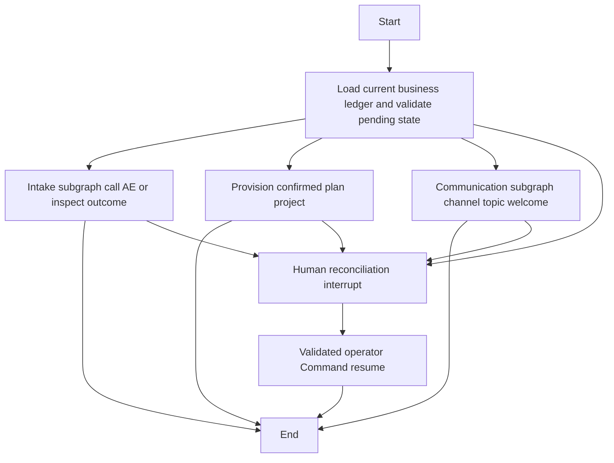
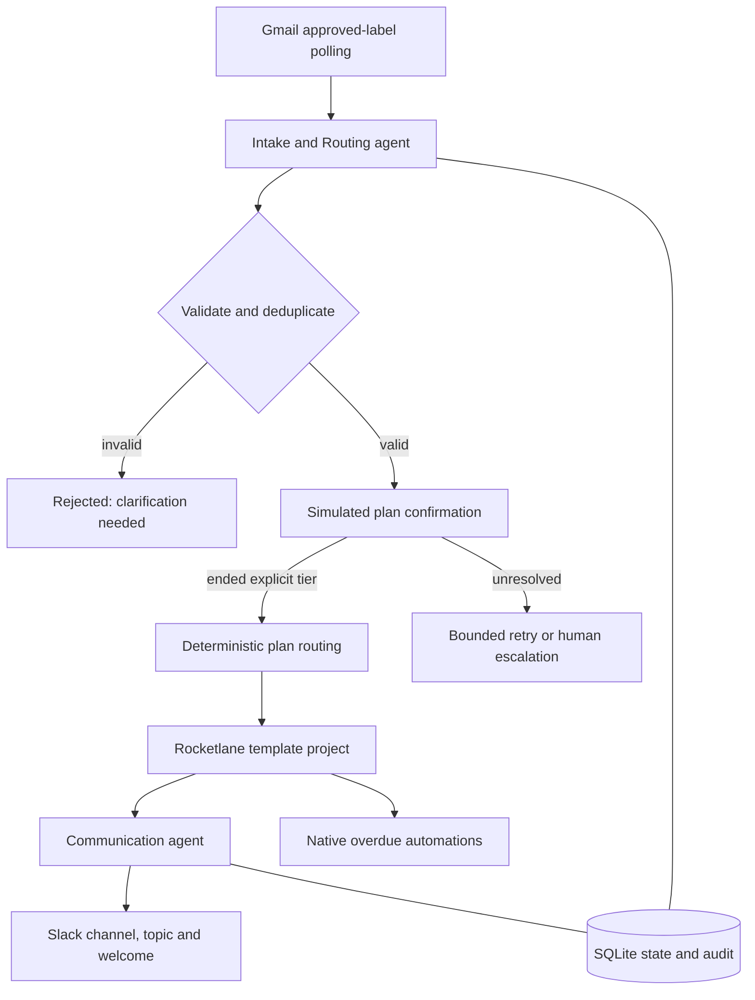

> Current implementation: telephone integration is not installed. Demo mode simulates confirmation; live call initiation fails closed. Historical real-call records cannot be advanced with simulated answers.

# Architecture

The application now uses custom Python LangGraph orchestration. `Workflow` remains the public facade; `app/graph_workflow.py` builds the graph and `app/operations.py` implements guarded actions. Intake parsing runs when a message is ingested; the intake subgraph owns outbound call and result routing. Communication is a separate subgraph. Optional structured models perform extraction and welcome drafting; default agents are deterministic.

## Implemented graph

One `step` executes one selected action. `run` continues ready actions until terminal state, pending voice or scheduled retry. The worker polls Gmail and runs due customers automatically. `graph` prints topology from the compiled graph. A run ID is its stable LangGraph thread ID. Graph state uses typed run ID, business snapshot and route fields; detailed plan phases, resource IDs and evidence are in the snapshot.

## Persistence and recovery

SQLite business state and audit remain in the selected database. `SqliteSaver` checkpoints use a separate adjacent `DATABASE.checkpoints.db` file, avoiding shared-transaction coupling with provider writes. Checkpoints and the ledger are not a distributed transaction. Each graph invocation reloads current business state; a stale checkpoint never authorizes another write. Interrupted pending actions become reconciliation requests. Review uses a durable `interrupt()` and a validated `Command(resume=...)`; remote writes are outside the review node, which may restart. Evidence-bearing receipts make the operator update replay safe across checkpoint failure.

Optional model extraction rejects values absent from source text. Communication drafts must include the verified customer, plan, duration, CSM mode, project ID and verification requirement or fall back to deterministic text. No model response can select the final plan. Configure optional provider packages and credentials separately; tests inject structured fake models and make no model-provider requests.

## State transitions

`validated -> call_pending -> awaiting_voice -> confirmed -> project_pending -> project_created -> channel_pending -> channel_created -> add_member_pending -> team_adding/team_added -> topic_pending -> topic_set -> welcome_pending -> complete`.

The communication subgraph now adds the configured shared plus plan-specific team to the channel, one member per checkpointed action. `added_team_user_ids` records progress; `pending_member_id` identifies an uncertain invitation. `member_added` reconciliation requires evidence and the exact interrupted user ID. Channel and project IDs survive membership failures. Welcome occurs only after the team has been added. The free three-case simulation uses dummy PM/Owner and dedicated-versus-pooled CSM IDs; production membership uses configured real workspace IDs. An ambiguous voice response creates a saved clarification request and no downstream resources.

An ended unresolved voice result returns to `retry_voice`, then `call_pending`, up to three attempts. Invalid intake is `rejected`. An interrupted pending state or uncertain external write is `reconcile`. Provider failures and exhausted voice attempts become `escalated`. Operators use audited reconciliation after confirming provider resources.

## Transaction boundary

Persist intent before issuing a remote write; persist the returned ID and result afterward. There is no distributed transaction across SQLite and a provider. Therefore exactly-once remote writes cannot be promised. The system sacrifices automatic progress when results are unknown and requires reconciliation. A Slack retry never re-creates the retained project.

Run one worker. An OS file lock rejects a second local worker for the same database and releases on process exit. Stop it before running mutating operator commands. SQLite serializes state mutations, but remote calls occur outside database locks and there is no distributed lease. Multiple hosts or concurrent manual commands remain unsupported. Production needs PostgreSQL checkpoints and leases, an outbox, provider reconciliation, credential rotation, durable retry queues, an authenticated operator service, alert delivery, and retention controls.

Audit records intentionally capture decisions, action types, statuses and resource references through the run record without duplicating full emails, transcripts or secrets. Rejected input stores field errors rather than the raw email. Operator evidence must not include secrets.

Action intent/result details now contain structured redacted input/output references and rationale. Voice evidence records call ID, accepted plan and a response hash rather than retaining raw speech. No telephone provider is currently installed; demo evidence is simulated. Checkpoints contain customer context and must receive the same access restrictions and retention policy as the business database.
